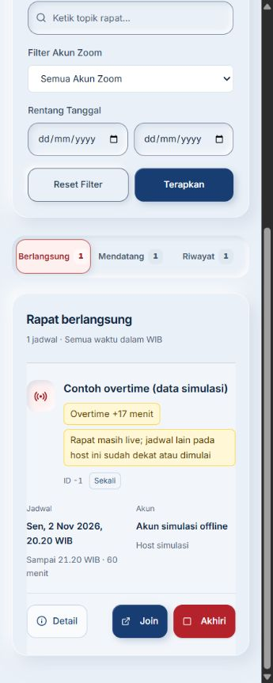
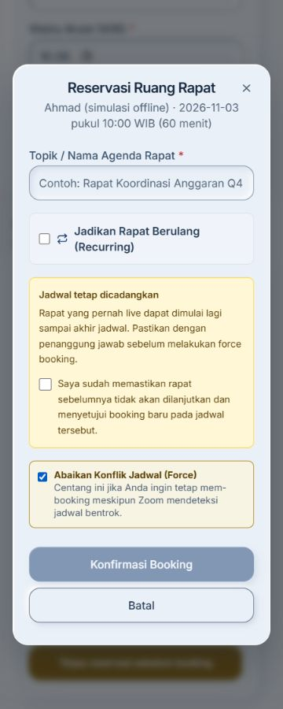

# Label kondisi rapat

Web menggunakan label `monitoring.labels` dari API pada dashboard, detail akun, jadwal, dan hasil pencarian. Overtime tetap dihitung sebagai meeting live, tidak menjadi status akun baru. Jika satu akun memiliki beberapa rapat live, jumlah sesi ditampilkan dan detail akun menampilkan seluruh rapat live yang diterima API.

Waktu pada baris rapat adalah jadwal, bukan prediksi waktu selesai aktual. Jadwal yang tidak diketahui ditampilkan apa adanya. Riwayat menampilkan jadwal terlewati dan tidak menyatakan rapat selesai tanpa bukti pelaksanaan.

Dashboard dan jadwal diperbarui setiap 30 detik saat aktif. Label tidak dihitung ulang dari jam komputer. Kondisi data lama dihitung dari waktu observasi/server API ditambah waktu sejak diterima. Pada umur 90 detik, atau saat pembaruan gagal, klaim status aktif diganti dengan status belum terverifikasi. Angka overtime tetap merupakan hasil pemeriksaan server terakhir, bukan stopwatch tanpa konfirmasi Zoom.

Hasil pencarian tetap diperbarui melalui tombol pencarian; informasi live di sana merupakan snapshot saat pencarian. Booking mempertahankan pemeriksaan ketersediaan ulang yang sudah ada.

## Verifikasi offline

- `npm test`: uji waktu observasi, perbedaan jam perangkat, label API, HTML escaping, dan penggantian label data lama.
- `npm run build` dan `npm run lint`.
- Preview khusus pengembangan: `/tests/monitoring-preview.html`. Fixture bertanda simulasi, bukan bagian entry produksi. Axios dan fetch diblokir; operasi tulis juga diganti fungsi penolak.
- Pemeriksaan browser: tab Mendatang, Berlangsung, Riwayat, dashboard dan detail akun. Label overtime serta risiko jadwal berikutnya tampil di desktop dan viewport 360 px; lebar dokumen sama dengan viewport tanpa overflow horizontal.

Gate tampilan untuk perubahan ini:

- Hard gate PASS: tidak menambah tindakan meeting; label data simulasi eksplisit; tidak ada overflow pada viewport 360 px.
- Purpose gate PASS: warna amber dan label teks menandai kondisi yang perlu perhatian operator; tidak mengandalkan warna saja.
- Liveliness PASS: mengikuti desain aplikasi, ENERGY 1 / RHYTHM 2 / MOTION 1; judul rapat tetap menjadi fokus kartu.
- Craftsmanship PASS: build/lint/uji otomatis lulus; perpindahan kategori dan detail akun diperiksa lewat browser dengan semua API eksternal diblokir.

## Reservasi yang pernah live

Label `ended_reserved` dan `previously_live_reserved` tidak membebaskan slot. Hasil pencarian menjelaskan bahwa rapat bisa dimulai lagi sampai batas jadwal. Modal force booking menambahkan checkbox konfirmasi yang tidak dipilih otomatis. Submit force booking tertahan hingga operator mengonfirmasi; backend melakukan pemeriksaan ulang dan dapat mengembalikan `RESERVATION_CONFIRMATION_REQUIRED` jika keadaan berubah sejak pencarian. Modal akan menampilkan konfirmasi yang baru diwajibkan tersebut.

Validasi browser: jalur jadwal ke pencarian, hasil reservasi, buka modal, centang Force tanpa konfirmasi (submit disabled), centang konfirmasi (submit enabled), hapus konfirmasi (disabled), dan Batal. Tidak mengirim booking. Pada viewport 360 px, lebar dokumen sama dengan viewport; seluruh teks dan checkbox tetap terbaca.

Gate tambahan: Hard PASS (tidak ada overflow/konfirmasi otomatis), Purpose PASS (peringatan menjelaskan risiko reservasi), Liveliness PASS (desain dan dials sama), Craftsmanship PASS (kontrol diperiksa, unit test dan build/lint lulus).

